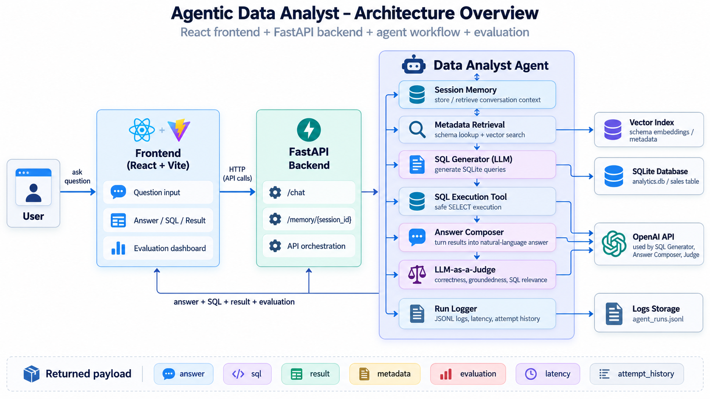

# Agentic Data Analyst

[Live Demo](https://agentic-data-analyst-seven.vercel.app) | [GitHub Repository](https://github.com/yg14uv/agentic-data-analyst)

> A full-stack agentic AI data analysis application that turns natural-language business questions into grounded SQL answers.

The application combines an LLM with metadata retrieval, semantic search, tool calling, SQL execution, retry/self-correction, session memory, automated evaluation, and execution logging.

Instead of asking users to understand the database schema or manually write SQL, the system can answer questions such as:

```text
How much money did we make in Canada?
```

and return:

- a natural-language answer
- the SQL generated by the agent
- the actual database result
- metadata used by the agent
- tool execution attempts
- latency
- an LLM-based quality evaluation

---

# Live Demo

Try the deployed application here:

**https://agentic-data-analyst-seven.vercel.app**

Example question:

```text
How much money did we make in Canada?
```

Expected result:

```text
Total revenue from Canada: 1770
```

The live system consists of:

- Frontend: React + Vite deployed on Vercel
- Backend: FastAPI deployed on Render
- LLM: OpenAI Responses API
- Database: SQLite
- Metadata Search: Embeddings + cosine similarity
- Evaluation: LLM-as-a-Judge

> Note: the backend currently uses a free Render instance. If the service has been inactive, the first request may take longer while the backend starts.

---

# Architecture



The application follows this overall flow:

```text
User
  |
  v
React Frontend
  |
  | HTTP request
  v
FastAPI Backend
  |
  v
Data Analyst Agent
  |
  +-------------------------+
  |                         |
  v                         v
Session Memory       Metadata Retrieval
                            |
                            v
                    Vector Similarity Search
                            |
                            v
                      Relevant Schema
                            |
                            v
                     LLM Tool Calling
                            |
                            v
                       SQL Generator
                            |
                            v
                    Read-Only SQL Tool
                            |
                            v
                      SQLite Database
                            |
                            v
                    Natural-Language Answer
                            |
                            v
                     LLM-as-a-Judge
                            |
                            v
                        Run Logger
```

---

# What Problem Does This Project Solve?

Data users often know the business question they want to ask but do not know:

- which database table contains the data
- which columns should be used
- how the tables are structured
- what SQL query should be written
- whether the generated SQL is valid
- whether the final AI answer is actually supported by the data

A simple chatbot can generate SQL, but that does not automatically make it reliable.

This project adds several layers around the LLM to make the workflow more agentic and more grounded.

The system:

1. understands the user's question
2. retrieves relevant database metadata
3. decides whether a tool should be called
4. generates SQL
5. safely executes the query
6. receives the real database result
7. corrects SQL when execution fails
8. produces a natural-language answer
9. evaluates the answer automatically
10. logs the full run for later inspection

---

# Core Features

## 1. Natural-Language Data Analysis

Users can ask business questions without writing SQL.

Example:

```text
Which country generated the most revenue?
```

The system converts the question into SQL, executes the query, and summarizes the real result.

---

## 2. LLM Tool Calling

The application uses real function/tool calling.

Instead of manually forcing a SQL query for every user message, the model has access to a tool:

```text
execute_sql
```

The agent decides when database access is required and provides the SQL query as the tool argument.

Conceptually:

```text
User Question
     |
     v
LLM
     |
     | decides to use tool
     v
execute_sql
     |
     v
Database
```

---

## 3. Read-Only SQL Safety

The SQL tool only accepts queries beginning with:

```sql
SELECT
```

Destructive operations are rejected.

For example:

```sql
DELETE FROM sales;
```

will not execute.

This prevents the agent from changing or deleting database records.

---

## 4. SQL Retry and Self-Correction

LLMs do not always generate correct SQL on the first attempt.

The application therefore supports retry and self-correction.

Example:

```text
Attempt 1

SELECT total_sales FROM sales;
```

Database response:

```text
no such column: total_sales
```

The agent receives the error and can correct itself:

```sql
SELECT SUM(revenue)
FROM sales;
```

The system currently supports up to three attempts.

This creates an agent loop:

```text
Generate SQL
    |
    v
Execute
    |
    +---- success ----> continue
    |
    +---- error ------> return error to LLM
                            |
                            v
                       generate fix
```

---

## 5. Dynamic Schema Discovery

The application does not depend entirely on a manually written schema prompt.

It reads the SQLite database structure dynamically using:

```sql
sqlite_master
```

and:

```sql
PRAGMA table_info(...)
```

This allows the metadata layer to understand the actual database structure.

---

## 6. Semantic Metadata Retrieval

One of the key features of the project is semantic schema retrieval.

Database metadata is embedded using:

```text
text-embedding-3-small
```

The user's question is also embedded.

Cosine similarity is then used to find the database metadata most relevant to the question.

For example, the user may ask:

```text
How much money did we make?
```

The user never says:

```text
revenue
```

but semantic retrieval can still identify the `revenue` column as relevant.

This becomes increasingly useful when database schemas become too large to place directly into every LLM prompt.

---

# Vector Index

Metadata embeddings are generated ahead of time and written to:

```text
backend/metadata/vector_index.json
```

This avoids embedding every table for every user request.

At runtime:

```text
User question
     |
     v
Question embedding
     |
     v
Cosine similarity
     |
     v
Prebuilt metadata vectors
     |
     v
Top relevant schema
```

The index can be regenerated with:

```powershell
python backend\metadata\build_index.py
```

The deployed Render backend also rebuilds the vector index during the build process.

---

# Multi-Turn Session Memory

The application supports conversational context.

Example:

```text
User:
How much money did we make in Canada?

Agent:
1770
```

Then:

```text
User:
What about the United States?
```

The second question does not explicitly mention revenue.

The session memory allows the agent to infer that the user is still asking about revenue.

Current memory is stored in process memory:

```text
session_id -> conversation history
```

This is suitable for the MVP, although a production system would typically use persistent storage such as Redis, PostgreSQL, or another state store.

---

# LLM-as-a-Judge

Every successful analytical answer can be evaluated by another LLM call.

The evaluator scores:

- correctness
- groundedness
- SQL relevance
- overall quality

Example:

```json
{
  "correctness_score": 5,
  "groundedness_score": 5,
  "sql_relevance_score": 5,
  "overall_score": 5,
  "passed": true
}
```

Structured Outputs are used so the evaluator returns a predictable JSON structure.

This creates an automated evaluation layer rather than relying only on manual inspection.

---

# Agent Logging

Each run can be logged as JSONL.

Example fields include:

```text
run_id
timestamp
session_id
question
metadata
similarity_score
sql
sql_result
attempt_history
answer
evaluation
latency_ms
```

Local development logs are written to:

```text
backend/logs/agent_runs.jsonl
```

Runtime logs are excluded from Git.

This logging layer could later be used for:

- failure analysis
- prompt optimization
- agent evaluation datasets
- latency monitoring
- tool usage analysis
- regression testing

---

# Frontend

The frontend is built with:

```text
React
Vite
JavaScript
CSS
```

The UI is designed not only to show the answer, but also to expose what the agent did.

The interface displays:

## Answer

The natural-language result generated from the database output.

## Tool Attempts

How many SQL execution attempts were needed.

## Latency

Total request latency.

## Metadata Matches

How many metadata objects were retrieved.

## Generated SQL

The actual SQL created by the agent.

## Query Result

The real database response shown as a table.

## Metadata Retrieval

The schema selected by semantic search and its similarity score.

## Evaluation

The LLM-as-a-Judge scores for:

```text
Correctness
Groundedness
SQL relevance
Overall quality
```

This makes the application useful as both a user-facing product and a technical demonstration of the underlying agent workflow.

---

# Backend API

The backend is implemented using FastAPI.

Local API:

```text
http://127.0.0.1:8000
```

Deployed backend:

```text
https://agentic-data-analyst-vh6e.onrender.com
```

---

## Health / Root Endpoint

```http
GET /
```

Example response:

```json
{
  "message": "Agentic Data Analyst API is running"
}
```

---

## Chat Endpoint

```http
POST /chat
```

Example request:

```json
{
  "message": "How much money did we make in Canada?",
  "session_id": "demo-session"
}
```

Example response structure:

```json
{
  "answer": "Total revenue from Canada: 1770",
  "sql": "SELECT SUM(revenue) AS total_revenue FROM sales WHERE country = 'Canada';",
  "result": {
    "success": true,
    "columns": [
      "total_revenue"
    ],
    "rows": [
      [
        1770
      ]
    ]
  },
  "metadata": [],
  "attempts": 1,
  "evaluation": {
    "correctness_score": 5,
    "groundedness_score": 5,
    "sql_relevance_score": 5,
    "overall_score": 5,
    "passed": true
  },
  "latency_ms": 8000
}
```

---

## View Session Memory

```http
GET /memory/{session_id}
```

Example:

```text
GET /memory/demo-session
```

---

## Clear Session Memory

```http
DELETE /memory/{session_id}
```

Example:

```text
DELETE /memory/demo-session
```

---

# Sample Database

The current MVP uses a small SQLite `sales` dataset.

Schema:

```text
sales
```

Columns:

```text
order_id
order_date
product
country
revenue
```

Sample records include products such as:

```text
Laptop
Monitor
Keyboard
```

and countries such as:

```text
Canada
United States
```

The intentionally small database makes the architecture easy to understand and test.

The same architecture could later be connected to larger data platforms such as:

```text
PostgreSQL
SQL Server
Snowflake
BigQuery
Databricks
```

---

# Demo Questions

These questions demonstrate different parts of the system.

## Basic Aggregation

```text
How much money did we make in Canada?
```

Expected result:

```text
1770
```

Demonstrates:

```text
Natural language
→ metadata retrieval
→ SQL generation
→ SQL execution
→ grounded answer
```

---

## Grouping and Ranking

```text
Which country generated the most revenue?
```

Expected result:

```text
United States
```

Revenue totals:

```text
United States: 1850
Canada: 1770
```

Demonstrates:

```text
GROUP BY
ORDER BY
ranking
```

---

## Product Analysis

```text
Show revenue by product.
```

Expected output:

```text
Laptop: 2550
Monitor: 950
Keyboard: 120
```

---

## Semantic Retrieval

```text
How much money did we make?
```

Expected total:

```text
3620
```

This demonstrates semantic retrieval because the user says:

```text
money
```

rather than explicitly naming the database column:

```text
revenue
```

---

## Multi-Turn Memory

First ask:

```text
How much money did we make in Canada?
```

Then:

```text
What about the United States?
```

Expected second result:

```text
1850
```

This demonstrates session memory and contextual follow-up handling.

---

# Project Structure

```text
agentic-data-analyst/
│
├── backend/
│   │
│   ├── agents/
│   │   ├── __init__.py
│   │   └── data_analyst.py
│   │
│   ├── app/
│   │   ├── __init__.py
│   │   └── main.py
│   │
│   ├── data/
│   │   └── analytics.db
│   │
│   ├── evaluation/
│   │   ├── __init__.py
│   │   └── judge.py
│   │
│   ├── logs/
│   │   ├── __init__.py
│   │   └── logger.py
│   │
│   ├── memory/
│   │   ├── __init__.py
│   │   └── store.py
│   │
│   ├── metadata/
│   │   ├── __init__.py
│   │   ├── build_index.py
│   │   ├── schema.py
│   │   └── search.py
│   │
│   ├── tools/
│   │   ├── __init__.py
│   │   └── sql_tool.py
│   │
│   └── create_database.py
│
├── frontend/
│   │
│   ├── src/
│   │   ├── App.jsx
│   │   ├── App.css
│   │   └── main.jsx
│   │
│   ├── package.json
│   └── vite.config.js
│
├── docs/
│   └── architecture.png
│
├── requirements.txt
├── .gitignore
└── README.md
```

---

# Tech Stack

## Frontend

```text
React
Vite
JavaScript
CSS
```

## Backend

```text
Python 3
FastAPI
Uvicorn
Pydantic
```

## AI

```text
OpenAI Responses API
GPT-5-mini
text-embedding-3-small
Tool Calling
Structured Outputs
```

## Data

```text
SQLite
SQL
Dynamic schema discovery
Vector metadata retrieval
Cosine similarity
```

## Agent Engineering

```text
Tool Calling
Retry / Self-Correction
Session Memory
Metadata Retrieval
Vector Search
LLM-as-a-Judge
Execution Logging
```

## Deployment

```text
Vercel
Render
GitHub
```

---

# Running the Project Locally

## Prerequisites

Install:

```text
Python 3.12+
Node.js
npm
Git
```

You also need an OpenAI API key.

---

## 1. Clone the Repository

```powershell
git clone https://github.com/yg14uv/agentic-data-analyst.git
cd agentic-data-analyst
```

---

## 2. Create a Python Virtual Environment

Windows:

```powershell
py -3.12 -m venv .venv
```

Activate it:

```powershell
.\.venv\Scripts\Activate.ps1
```

---

## 3. Install Backend Dependencies

```powershell
pip install -r requirements.txt
```

---

## 4. Configure Environment Variables

Create a file in the repository root called:

```text
.env
```

Add:

```text
OPENAI_API_KEY=your_openai_api_key
```

Never commit `.env` to Git.

---

## 5. Create the Sample Database

```powershell
python backend\create_database.py
```

This creates:

```text
backend/data/analytics.db
```

---

## 6. Build the Metadata Vector Index

Run:

```powershell
python backend\metadata\build_index.py
```

This generates:

```text
backend/metadata/vector_index.json
```

---

## 7. Start the Backend

```powershell
uvicorn backend.app.main:app --reload
```

Backend:

```text
http://127.0.0.1:8000
```

FastAPI Swagger documentation:

```text
http://127.0.0.1:8000/docs
```

---

## 8. Configure the Frontend

Create:

```text
frontend/.env.local
```

Add:

```text
VITE_API_URL=http://127.0.0.1:8000
```

---

## 9. Install Frontend Dependencies

Open another terminal:

```powershell
cd frontend
npm install
```

---

## 10. Start the Frontend

```powershell
npm run dev
```

Open:

```text
http://localhost:5173
```

You should now see the Agentic Data Analyst UI.

---

# Deployment Architecture

The production application is deployed using two services.

## Frontend

Hosted on Vercel:

```text
https://agentic-data-analyst-seven.vercel.app
```

Production environment variable:

```text
VITE_API_URL=https://agentic-data-analyst-vh6e.onrender.com
```

---

## Backend

Hosted on Render:

```text
https://agentic-data-analyst-vh6e.onrender.com
```

Render build command:

```bash
pip install -r requirements.txt && python backend/metadata/build_index.py
```

Render start command:

```bash
uvicorn backend.app.main:app --host 0.0.0.0 --port $PORT
```

Render environment variables:

```text
OPENAI_API_KEY=<secret>
FRONTEND_URL=https://agentic-data-analyst-seven.vercel.app
```

---

# Reliability and Safety Design

Several safeguards are built into the application.

## Database Grounding

The final answer is generated from actual SQL execution results rather than relying only on the model's internal knowledge.

## Read-Only SQL

Only `SELECT` statements are allowed.

## Metadata Grounding

The model receives database metadata relevant to the current question.

## Execution Feedback

SQL errors are returned to the model so it can repair the query.

## Retry Limit

The agent has a maximum number of SQL attempts to prevent uncontrolled loops.

## Evaluation

Successful responses are automatically evaluated by an LLM judge.

## Logging

Each agent run can be recorded for inspection.

---

# Current Limitations

This project is intentionally an MVP.

Current limitations include:

- SQLite rather than an enterprise data warehouse
- small sample dataset
- in-memory conversation state
- JSON-based local vector index
- no user authentication
- no role-based database permissions
- no streaming responses
- no chart generation
- one main data-analysis agent rather than a multi-agent system
- LLM-as-a-Judge adds additional latency and API cost
- the free Render backend can experience cold starts

These are engineering tradeoffs rather than hidden limitations.

---

# Future Improvements

Possible next iterations include:

## Data Infrastructure

```text
PostgreSQL
Snowflake
SQL Server
BigQuery
Databricks
```

## Agent Architecture

```text
Orchestrator Agent
SQL Specialist Agent
Visualization Agent
Data Quality Agent
Business Insight Agent
```

## Memory

```text
Redis
PostgreSQL
Persistent conversation history
Long-term user context
```

## Retrieval

```text
Dedicated vector database
pgvector
Pinecone
Qdrant
Weaviate
```

## Security

```text
Authentication
Role-based access control
Row-level security
Query allowlists
Audit controls
```

## Observability

```text
Tracing
Token usage
Cost monitoring
Tool success rate
Evaluation dashboards
Latency dashboards
```

## User Experience

```text
Streaming answers
Chart generation
Saved conversations
Suggested questions
File upload
CSV analysis
Exportable reports
```

---

# Key Engineering Lessons

This project demonstrates that building a useful AI data agent involves much more than calling an LLM.

The LLM is only one component.

A more reliable system requires:

```text
LLM reasoning
+
retrieval
+
tools
+
database execution
+
memory
+
error handling
+
evaluation
+
logging
+
frontend/backend integration
+
deployment
```

The core workflow of the project can be summarized as:

```text
Understand
→ Retrieve
→ Decide
→ Execute
→ Observe
→ Correct
→ Answer
→ Evaluate
→ Log
```

---

# Why I Built This

The goal of this project was to understand how modern LLMs can be combined with traditional data engineering and analytics systems.

Rather than building a chatbot that simply generates text, I wanted to build a system that could:

- interact with real data
- retrieve the right context
- decide when to use tools
- recover from errors
- preserve conversational context
- evaluate its own output
- expose the reasoning workflow through a usable interface

The result is a small but complete example of an agentic data application, covering the full lifecycle from local development to cloud deployment.

---

# License

This project is intended for educational, experimentation, and portfolio purposes.